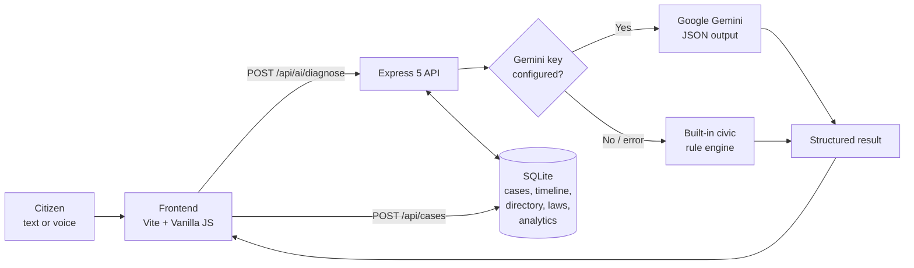

AINA — AI National Assistant 🇵🇰
قومی معاون برائے شہری امور
Practical AI guidance for everyday civic problems in Pakistan — in English and Urdu.


-003B57?logo=sqlite)

NYLP AI Hackathon 2026 · Building AI Products · AI for National Advancement
</div>
---
🔗 Project Links
Resource	Link
🌐 Live Product	`TODO: add deployed application URL`
🎬 Demo Video	`TODO: add demo video URL`
💻 GitHub Repository	`TODO: add public repository URL`
🏆 Hackathon	National Youth Leadership Program (NYLP) AI Hackathon 2026
> Replace the three `TODO` entries before submission.
---
📑 Table of Contents
Problem Statement
Our Solution
Target Users
Key Features
How It Works (Architecture)
AI Methodology
Technology Stack
Project Structure
Local Setup and Installation
Configuration Reference
REST API Reference
Data and Knowledge Base
Screenshots
Product Demo
Current Status and Limitations
Privacy, Safety, and Responsible AI
Deployment Notes
Meet the Team
Future Roadmap
Hackathon Submission
---
📌 1. Problem Statement
Citizens often struggle to resolve everyday civic problems. They may not know which department is responsible, what law protects them, what steps to take, what information to provide, or how to write a clear complaint or application. Reliable guidance is scattered across many sources and is often written in complicated language.
Typical examples include an unexplained electricity "detection bill", a police station refusing to register an FIR, a blocked CNIC, an online fraud, or garbage and broken roads that nobody fixes.
AINA bridges this gap by turning a plain-language description of a problem into understandable guidance and a ready-to-edit complaint.
💡 2. Our Solution
AINA — AI National Assistant is an AI-assisted civic guidance platform.
```
PROBLEM  →  UNDERSTAND  →  GUIDE  →  GENERATE  →  TAKE ACTION
```
Step	What happens in AINA
Problem	The user describes the issue by typing or by voice, in English, Urdu, or Roman Urdu.
Understand	The AI engine summarizes the issue, assigns a category, and rates severity.
Guide	AINA suggests the likely responsible authority, the governing law, the expected timeframe, an escalation path, and a multi-phase action roadmap.
Generate	AINA drafts a formal complaint or application in English and Urdu, ready to edit and print.
Take Action	The user reviews the draft, saves it as a tracked case, prints it or saves it as PDF, and files it with the relevant office.
AINA supports citizens. It does not replace official authorities and does not guarantee that a complaint will be accepted or resolved.
🎯 3. Target Users
Citizens seeking guidance about everyday civic problems.
Community organizations supporting people with local issues.
NGOs and public-service support initiatives.
Researchers and decision-makers interested in recurring civic challenges (through aggregated, anonymous platform statistics).
✨ 4. Key Features
Feature	Description	Status
Civic Problem Submission	Free-text problem input with optional follow-up clarification questions.	✅ Working
Bilingual Interface	Full English and Urdu (اردو) interface, with RTL support for Urdu.	✅ Working
AI-Powered Understanding	Summary, category, and severity for the submitted issue.	✅ Working
Actionable Roadmap	Phased next steps with departments, laws, helplines, and timeframes.	✅ Working
Department Guidance	Suggests the responsible authority, sub-department, and escalation officer.	✅ Working (see limitations)
Complaint / Application Drafting	Editable formal drafts in English and Urdu, with print / save-as-PDF.	✅ Working
Voice Input and Read-Aloud	Speech-to-text and text-to-speech (Urdu and English) using the browser's Web Speech API.	✅ Working in supported browsers (Chrome / Edge)
Case Tracking	Save a draft as a case, receive a tracking ID (e.g. `AINA-PK-2026-X8F2`), record diary numbers, and view a status timeline.	✅ Working
Civic Directory	Helplines and official portals searchable by category.	✅ Working
Rights and Laws Library	Summaries of relevant Pakistani statutes, sections, timeframes, and penalty clauses.	✅ Working
Platform Analytics	Aggregated, anonymous counts of diagnoses, cases, and categories.	✅ Working (API)
Light / Dark Theme	Theme toggle for comfortable use.	✅ Working
Optional Live LLM	Google Gemini can be enabled with an API key for generated responses.	✅ Optional
Image Input	Photo or document upload.	🔜 Not implemented
Supported Problem Categories
Category	Examples
⚡ Electricity, Gas & Water	Overbilling, defective meters, detection bills, gas pressure
🪪 NADRA, Passport & Excise	CNIC blocking, name correction, passport delay
🛡️ Police, FIR & Security	Refusal to register an FIR, lost property report, harassment
💻 FIA Cybercrime & Online Fraud	Account hacking, OTP phishing, online blackmail
🏙️ Municipal, Sanitation & Encroachment	Garbage, broken roads, open manholes, street lights
⚖️ Consumer Protection & Rights	Defective goods, refunds, consumer court complaints
🏛️ Ombudsman and Public Grievances	Maladministration, delays by public offices
👩 Women's Protection	Harassment and women's safety helplines
🧱 5. How It Works

The frontend sends the problem description to the backend.
The backend uses Gemini if a key is available. If no key is set, or the call fails or times out (15 seconds), it falls back to the built-in rule engine, so the product always responds.
The result (summary, category, roadmap, bilingual drafts) is shown for review and editing.
The user can save it as a case. The backend stores it in SQLite, generates a tracking ID, masks the CNIC, and keeps a timeline of milestones.
🧠 6. AI Methodology
AINA uses a hybrid approach so it remains useful with or without an external AI service.
6.1 Intended and implemented workflow
Input processing: the backend validates the description (minimum length, schema checks with Zod) and detects the language.
Context understanding and classification: the issue is mapped to one of the 8 supported categories with a severity level.
Guidance generation: authority, governing law, statutory timeframe, escalation officer, a phased roadmap, and clarification questions.
Structured output: a single JSON object containing English and Urdu summaries and complete English and Urdu complaint drafts.
Human review: the user reviews and edits everything before saving, printing, or filing.
6.2 Model and API usage
Item	Details
AI provider	Google Gemini (optional)
Default model	`gemini-1.5-flash`, configurable through `GEMINI_MODEL` (see note below)
API	Gemini REST API, `generateContent` endpoint, called from the backend with `fetch`
AI tasks	Issue summarization, categorization, severity rating, roadmap generation, clarification questions, bilingual complaint drafting
Prompting method	A system-style instruction defining the AINA role plus a strict JSON schema; user input and optional context are appended; `temperature = 0.2` and `responseMimeType = application/json` for consistent structured output
Fallback	Built-in rule-based "Pakistani Civic Intelligence Engine" (keyword and pattern matching across the 8 categories, bilingual templates)
External knowledge sources	None integrated at runtime. Reference data comes from a curated local dataset (see Section 12)
Voice	Browser Web Speech API (`SpeechRecognition`, `speechSynthesis`), not a server-side AI service
> **Note on the model name:** `gemini-1.5-flash` is the default in the code. Google retires older model versions over time, so set `GEMINI_MODEL` to a currently available Gemini model if live calls fail. If a call fails, AINA automatically falls back to the built-in engine.
6.3 What AINA does not do
It does not train or fine-tune any model.
It does not use retrieval-augmented generation (RAG) or live legal databases.
AI-generated institutional and legal guidance is not officially verified. Always confirm with the relevant authority.
🛠️ 7. Technology Stack
Layer	Technology
Frontend	Vanilla JavaScript (ES modules), HTML5, CSS3, Vite
Backend	Node.js, Express 5
Languages	JavaScript (ES modules), SQL, HTML, CSS
AI integration	Google Gemini REST API (optional) + built-in rule engine
Voice	Web Speech API (speech recognition and speech synthesis)
Database	SQLite via Node's native `node:sqlite` module (WAL mode, foreign keys enabled)
Validation	Zod
Security middleware	Helmet, CORS
Logging	Morgan and a custom request logger
Dev tooling	concurrently (runs API and frontend together)
Authentication	None in the current prototype
Deployment	Not yet deployed. See Section 17
📁 8. Project Structure
```
ANA/
├── backend/
│   ├── config/
│   │   ├── env.js                # Environment loader with defaults
│   │   └── db.js                 # node:sqlite connector (WAL) and schema init
│   ├── data/                     # SQLite database files (generated at runtime)
│   ├── db/
│   │   ├── schema.sql            # Tables: cases, case_timeline, civic_directory,
│   │   │                         #         legal_statutes, analytics_events
│   │   └── seed.js               # Seeds directory and statutes
│   ├── middleware/
│   │   ├── errorHandler.js       # Centralized JSON error and 404 handling
│   │   ├── requestLogger.js      # Request logging with timing
│   │   └── validate.js           # Reusable Zod validation middleware
│   ├── routes/                   # ai, cases, directory, laws, analytics, health
│   ├── services/
│   │   ├── aiService.js          # Gemini call + built-in rule engine
│   │   ├── caseService.js        # Tracking IDs, CNIC masking, petition export
│   │   ├── directoryService.js
│   │   ├── lawsService.js
│   │   └── analyticsService.js
│   ├── app.js                    # Express app and middleware assembly
│   ├── server.js                 # Entry point, seeding, graceful shutdown
│   └── README.md                 # Detailed backend documentation
├── src/
│   ├── main.js                   # UI logic, tabs, i18n, case tracking, drafter
│   ├── aiEngine.js               # Client-side engine / API orchestration
│   ├── apiClient.js              # Frontend client for /api endpoints
│   ├── civicData.js              # Categories and civic knowledge data
│   └── speech.js                 # Voice input and read-aloud (ur-PK / en-US)
├── index.html                    # Application shell (5 tabs + settings)
├── style.css                     # Styles (light/dark, RTL support)
├── vite.config.js                # Dev server on 5173, /api proxy to :5000
├── package.json                  # Scripts and dependencies
├── .env.example                  # Environment template (no secrets)
└── README.md
```
⚙️ 9. Local Setup and Installation
Prerequisites
Git
Node.js 22.13 or newer (Node 24 recommended). The backend uses the built-in `node:sqlite` module, so no native database driver needs to be compiled.
npm (included with Node.js)
Optional: a Google Gemini API key for live LLM responses
Installation
```bash
git clone <YOUR_GITHUB_REPOSITORY_URL>
cd <YOUR_PROJECT_DIRECTORY>
npm install
```
Environment configuration
```bash
cp .env.example .env        # macOS / Linux
copy .env.example .env      # Windows (cmd)
```
Open `.env` and adjust values if needed. Leaving `GEMINI_API_KEY` empty is fine: AINA then runs entirely on its built-in engine.
Run the application
```bash
npm run dev
```
This starts both services:
Service	URL
Frontend (Vite)	http://localhost:5173
Backend API	http://localhost:5000
Health check	http://localhost:5000/api/health
Open http://localhost:5173 in your browser. For voice input, use Chrome or Edge.
Available scripts
Command	Purpose
`npm run dev`	Run backend and frontend together
`npm run server`	Run only the backend (port 5000)
`npm run client`	Run only the Vite frontend (port 5173, proxies `/api`)
`npm run seed`	Re-seed the civic directory and statutes
`npm run build`	Build the production frontend into `dist/`
`npm run preview`	Preview the production build
`npm start`	Start the backend in production mode
Quick verification
```bash
curl http://localhost:5000/api/health
```
A healthy response reports `"status": "online"` and the database as `healthy`.
🔧 10. Configuration Reference
Variable	Default	Description
`PORT`	`5000`	Backend port
`NODE_ENV`	`development`	Runtime environment
`GEMINI_API_KEY`	(empty)	Optional server-side Gemini key. Empty means the built-in engine is used
`GEMINI_MODEL`	`gemini-1.5-flash`	Gemini model name used for live calls
`DB_PATH`	`backend/data/aina.sqlite`	SQLite database file location
`CORS_ORIGIN`	`*`	Allowed CORS origin. Restrict this in production
The Settings dialog in the UI also lets a user enter their own Gemini key and model. That key is stored in the browser's `localStorage` and sent with requests to the backend.
Security requirements
Never commit API keys, passwords, tokens, or the `.env` file.
Make sure `.env` and `backend/data/*.sqlite*` are listed in `.gitignore`.
Commit only the sanitized `.env.example`.
📡 11. REST API Reference
Base URL (local): `http://localhost:5000`
Method	Endpoint	Description
`GET`	`/api/health`	Server uptime, database status, AI provider status
`POST`	`/api/ai/diagnose`	Analyze a problem; returns category, authority, law, roadmap, questions, and bilingual drafts
`POST`	`/api/ai/draft`	Generate a standard complaint draft for a category
`POST`	`/api/cases`	Save a case and receive a tracking ID
`GET`	`/api/cases`	Search cases (`query`, `category`, `status`)
`GET`	`/api/cases/:trackingId`	Full case with timeline
`PATCH`	`/api/cases/:trackingId/status`	Update status and record a diary number
`POST`	`/api/cases/:trackingId/timeline`	Add a custom milestone
`GET`	`/api/cases/:trackingId/export?lang=en|ur`	Export a formatted petition
`GET`	`/api/directory`	Helplines and portals (`category`, `search`)
`GET`	`/api/directory/categories`	Directory counts by category
`GET`	`/api/laws`	Statutes (`category`)
`GET`	`/api/laws/:id`	A single statute
`GET`	`/api/analytics/overview`	Aggregated platform statistics
`POST`	`/api/analytics/event`	Record an anonymous usage event
Example: diagnose a problem
```bash
curl -X POST http://localhost:5000/api/ai/diagnose \
  -H "Content-Type: application/json" \
  -d '{"input": "My electricity bill has a 75,000 detection bill without any notice"}'
```
Abbreviated response:
```json
{
  "success": true,
  "data": {
    "category": "utilities",
    "severity": "High",
    "source": "AINA Pakistani Civic Intelligence Engine",
    "roadmap": [ { "phaseEn": "...", "tasksEn": ["..."] } ],
    "draftEn": { "subject": "...", "bodyParagraphs": ["..."] },
    "draftUr": { "subject": "...", "bodyParagraphs": ["..."] }
  }
}
```
Case lifecycle
`draft → filed → diary_assigned → under_investigation → hearing_scheduled → resolved` (or `escalated`)
See `backend/README.md` for the full backend documentation.
🗂️ 12. Data and Knowledge Base
AINA ships with a small, curated local dataset stored in SQLite and seeded on first start:
Dataset	Content	Size in this build
Civic directory	Emergency helplines, utility complaint desks, official portals	13 entries
Legal statutes	Acts, relevant sections, statutory timeframes, penalty clauses (English and Urdu)	6 entries
Categories	Supported civic problem categories	8 categories
This dataset is a starting point, not an official legal database. Phone numbers, portals, sections, and timeframes can change. Verify them with the relevant authority before relying on them.
🖥️ 13. Screenshots
> Add real screenshots of the working application to a `screenshots/` folder and update the paths below. Remove any entry you do not use.
View	Preview
Home / AI Assistant	``
Problem submission and AI guidance	``
Complaint drafter (English / Urdu)	``
Civic directory	``
Rights and laws	``
Case tracking	``
🎬 14. Product Demo
Demo video: `TODO: add demo video URL`
Suggested demo flow:
Open the application and switch between English and Urdu.
Describe a sample problem, for example: "My electricity bill has a 75,000 detection bill without notice." Try voice input.
Review the category, severity, authority, legal basis, and roadmap.
Answer a clarification question and open the generated complaint draft.
Edit the draft, save it as a case, and note the tracking ID.
Look up the case in the Tracking tab and update its status.
Browse the Directory and Rights tabs.
State the current limitations honestly.
✅ 15. Current Status and Limitations
Project status: Working prototype / MVP
Working features
Bilingual (English / Urdu) interface with light and dark themes
Text and voice problem input; read-aloud of guidance
Issue summary, category, severity, authority, legal basis, roadmap, and clarification questions
Bilingual complaint and application drafts with print / save-as-PDF
Case saving, tracking IDs, status updates, diary numbers, and timelines
Civic directory and rights library
Aggregated analytics API
Automatic fallback from Gemini to the built-in engine
Partially working or conditional
Live Gemini responses need a valid API key and an available model name.
Voice features depend on browser support (Chrome / Edge) and installed voices; Urdu voices vary by device.
Analytics are exposed through the API; the depth of the in-app analytics view is limited.
Not yet implemented
Image or document upload (multimodal image input)
User accounts and authentication
Retrieval from live or verified government sources
Automatic filing with government portals
Automated test suite
Known limitations
AI-generated information may be inaccurate and must be reviewed.
The built-in engine is rule-based and may misclassify unusual or mixed problems.
Official procedures, helplines, and institutional responsibilities change over time.
The local directory and statute dataset is small and not exhaustive.
Provincial and local differences are only partly covered.
A generated complaint does not guarantee official acceptance or resolution.
AINA is not legal advice.
🔐 16. Privacy, Safety, and Responsible AI
Data minimization: only the details needed to draft a complaint are requested.
CNIC masking: CNIC numbers are masked before being stored with a case (for example `35201-*****67-1`).
Local storage: case data is stored in a local SQLite database controlled by whoever runs the server.
Anonymous analytics: usage events record type, category, and language, not personal details.
Transparency: guidance is clearly AI-generated and not officially verified; users are encouraged to verify important facts.
Human in the loop: users review and edit every draft before filing.
Secrets: API keys must stay out of version control. A key entered in the Settings dialog is kept in the user's own browser.
Before a public deployment: restrict `CORS_ORIGIN`, add authentication and rate limiting, serve over HTTPS, and review what personal data is stored.
Not for emergencies: in danger, call the official emergency numbers (for example, Police 15).
🚢 17. Deployment Notes
`npm run build` produces the frontend in `dist/`.
The Express server in this repository serves the API only. Host `dist/` on a static host, or add static file serving, and route `/api` to the backend.
The backend needs a Node.js runtime with `node:sqlite` support and a persistent disk for the SQLite file (`DB_PATH`). Ephemeral file systems will lose saved cases.
Set `NODE_ENV=production`, a restrictive `CORS_ORIGIN`, and, if desired, `GEMINI_API_KEY` as host environment variables.
👥 18. Meet the Team
Team AINA — NYLP AI Hackathon 2026
	Member	Role	Contact
1	Asadullah Zahid	Project Lead · Full-Stack AI Developer	Email · LinkedIn
2	Muhammad Ahmad Bilal	Front-End Developer	Email · LinkedIn
3	Syed Sufyan Ahmed	Back-End Developer	Email · LinkedIn
4	Fatima Batool	AI Solutions & Product Design Specialist	Email · LinkedIn
Responsibilities
Asadullah Zahid: project vision, technical architecture, full-stack development, AI integration, team coordination.
Muhammad Ahmad Bilal: user interface, responsive layouts, interactive components, user experience.
Syed Sufyan Ahmed: server-side development, API design and integration, database management, application logic, backend reliability.
Fatima Batool: AI solution conceptualization, user-centric product design, documentation, solution planning, product presentation.
🚀 19. Future Roadmap
These are future opportunities, not existing capabilities.
[ ] Image and document upload (multimodal input)
[ ] Integration with verified public-service information sources and retrieval-based answers
[ ] Expanded, regularly reviewed directory and statute coverage, including provincial rules
[ ] More Pakistani languages (Sindhi, Pashto, Punjabi, Balochi)
[ ] User accounts, notifications, and status reminders
[ ] Improved complaint and application templates
[ ] Privacy-conscious civic issue analytics dashboard for NGOs and decision-makers
[ ] Automated tests, accessibility audit, and reliability improvements
[ ] Deployment with HTTPS, rate limiting, and monitoring
🏆 20. Hackathon Submission
	
Program	National Youth Leadership Program (NYLP)
Event	AI Hackathon 2026
Project	AINA — AI National Assistant
Team	Team AINA
AINA aims to show how thoughtfully applied AI can help people understand civic problems and identify practical next steps.
📄 License
Released under the MIT License (as declared in `package.json`). Add a `LICENSE` file to the repository root.
⚠️ Disclaimer
AINA provides general informational guidance only. It is not legal advice and is not affiliated with any government body. Verify all important information with the relevant authority.
---
<div align="center">
Building AI Products. Empowering Citizens. Innovating for Pakistan. 🇵🇰
</div>
